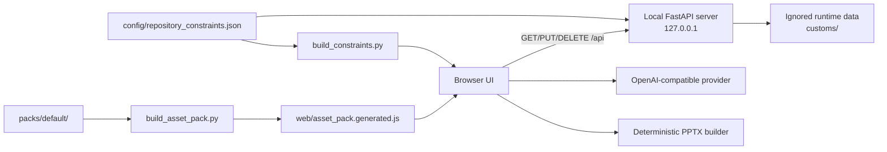
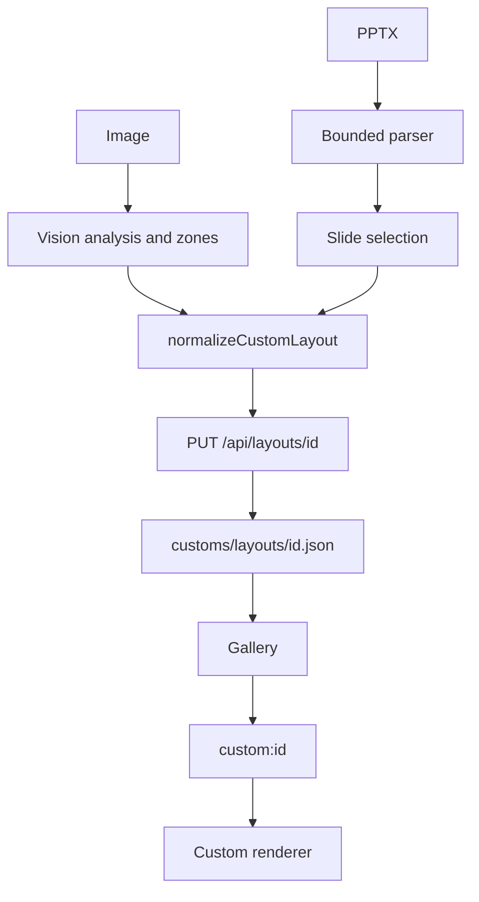

# Architecture

## Overview



`backend/server.py` serves the isolated `web/` application tree, persists validated JSON and optionally relays `/v1/*` requests to `LLM_BASE`. It binds only to `127.0.0.1`, accepts only loopback host names and applies same-origin checks to `/api/*` and `/v1/*`.

## Persistence

The backend exposes:

```text
GET    /api/state
PUT    /api/{layouts|icons|photos|history}/{id}
DELETE /api/{layouts|icons|photos|history}/{id}
PUT    /api/settings
PUT    /api/gallery
```

Collections use one file per entity. Settings and Gallery each use one document. Writes use a temporary file in the same directory, `fsync` and `os.replace`. Browser and server validators both enforce bounded IDs, allowlisted properties, image signatures and size limits. The data root resolves below `PPTGEN_DATA_DIR`, and runtime data is never served by the static router.

Vision enums, collection caps and size limits come from `config/repository_constraints.json`. Python reads the source directly; the browser loads the deterministic `web/core/constraints.generated.js` artifact.

`PPTGen.repoStore` loads `/api/state` before UI initialization. A mutation follows this sequence:

```text
client normalization → API request → server validation → atomic write → response → memory update → UI refresh
```

Failed responses therefore leave the in-memory session state unchanged.

## Custom layouts



PPTX imports are limited to 50 MiB compressed, 100 slides, 2,000 archive entries, 250 MiB decompressed, 10 MiB per XML part and 25 MiB per media item. Imported visual decorations are preserved while editable zones are populated by the plan.

## Backups and compatibility

The current full-backup format contains a manifest, settings, Gallery state and the four data collections. Restore validates every candidate, deduplicates by `(type, id)`, asks once before replacing entries and waits for every write. Versions 1 through 3 remain readable. Legacy presentation plans are normalized when loaded, while newly generated plans use the strict current layout schemas.

## Security boundaries

- The application server is loopback-only and guarded by `TrustedHost` plus same-origin validation.
- Untrusted UI data is inserted with safe DOM APIs.
- API keys remain tab-scoped unless the user explicitly writes `config/config.local.js`.
- Static routing blocks `.git`, runtime data, tests, tools, pack sources and local configuration.
- API JSON is limited to 4 MiB, proxied bodies to 32 MiB and the data store to 128 MiB.
- `file://` is read-only; persistence requires the local server.

## Quality gates

The official suite covers contracts, security, the PPTX parser, browser networking, repository persistence, migrations, backups, empty-data startup, SmartArt, end-to-end imports and generation, 20 built-in renderers and preview rendering. GitHub Actions runs the same `npm run check` command on Windows and Linux.
